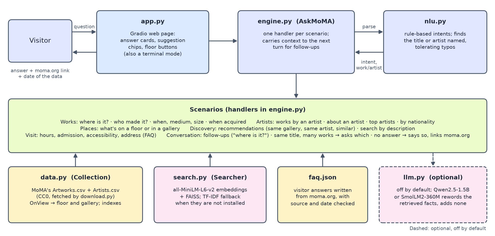

# AskMoMA

A conversational guide to the art on view at The Museum of Modern Art.
Group 4, MSAI-631-M80, University of the Cumberlands.

**Team:** Dipu Biswas, Heman Chongbang Limbu, Sarina Tamang, Soham Nitin Ghorpade, Xinran Peng

Ask in plain English, for example *"Where is The Starry Night?"*,
*"Who painted Water Lilies?"* or *"I loved The Starry Night. What else should I see?"*,
and AskMoMA answers from MoMA's own collection data, with a link back to
moma.org and the date of the data.

## 1. Setup

```bash
python -m venv .venv
source .venv/bin/activate        # Windows: .venv\Scripts\activate
pip install -r requirements.txt
```

Or, with [mise](https://mise.jdx.dev) and uv, which install the exact versions in `uv.lock`:

```bash
mise install          # Python 3.12 and uv
mise run setup        # core install: TF-IDF search, starts fast
mise run setup-full   # adds embedding search and the optional LLM (CPU-only PyTorch)
```

Without mise, `uv sync --all-extras` does the same as `setup-full`; install one extra with
`uv sync --extra embeddings` or `uv sync --extra llm`.

## 2. Get the data

The data is MoMA's public collection dataset
(<https://github.com/MuseumofModernArt/collection>, CC0). Put `Artworks.csv`
and `Artists.csv` in a `data/` folder next to `app.py`.

Download the two large files with:

```bash
mise run data
```

The files are stored with Git LFS upstream, so the download checks their size. If it reports a
Git LFS pointer, run it again later. Until the data is in place, you can try the app on the small
test data with `python app.py --data tests/fixtures`.

Set the date you pulled the data so answers say how current they are:

```bash
export ASKMOMA_DATA_AS_OF="November 20, 2026"
```

## 3. Run

```bash
python app.py                 # web UI at http://127.0.0.1:7860
python app.py --cli           # chat in the terminal
python app.py --share         # temporary public link (e.g. for the demo)
python app.py --data tests/fixtures   # tiny fictional test data
```

With the `embeddings` extra installed, search by description uses
all-MiniLM-L6-v2 sentence embeddings and a FAISS index, so "chairs and furniture
design" finds chairs even when no title contains those words. The first run
downloads the model (~90 MB) and encodes the works on view (about a minute on a
laptop); later runs load the vectors from `.cache/` in about a second. Without
the extra, search falls back to TF-IDF keyword matching.

With the `llm` extra installed and `ASKMOMA_LLM` set, a small language model
rewords single answers (lists are left as they are). It only sees the answer
AskMoMA already built, and its wording is used only if every link is kept, no
link is added, and no number (gallery, floor, date, price) is new; otherwise
the original answer is shown. It runs on the CPU, so each answer takes a few
seconds longer; `HuggingFaceTB/SmolLM2-360M-Instruct` is the lighter choice.

## 4. What it can answer

| Scenario | Example |
| --- | --- |
| Locate a work | Where is The Starry Night? / Is Water Lilies on view? |
| Who made it | Who painted The Starry Night? |
| Work details | When was it made? / What medium is it? / How big is it? |
| Acquisition | When did MoMA acquire Les Demoiselles d'Avignon? |
| Works by an artist | What works by Frida Kahlo are on view? / Show me paintings by Picasso |
| About an artist | Who was Piet Mondrian? |
| Recommendations | I loved The Starry Night. What else should I see? |
| Rank artists | Which artists have the most works on floor 5? |
| What's on a floor / gallery | What's on floor 4? / What's in gallery 501? |
| By nationality | Which Japanese artists are on view? |
| Search by description | Find dreamy night sky paintings |
| Follow-ups | Where is it? / What else did they make? |
| Same title, many works | Tell me about Untitled → asks which one |
| Visitor FAQ | Hours, admission, accessibility, address |
| No answer | Says so and links to moma.org |

Typos are tolerated ("starry nite", "Piccaso").

## 5. Options (environment variables)

| Variable | Default | Purpose |
| --- | --- | --- |
| `ASKMOMA_DATA_DIR` | `./data` | Folder with the CSVs |
| `ASKMOMA_DATA_AS_OF` | CSV file date | Date shown with every answer |
| `ASKMOMA_SEARCH_SCOPE` | `on_view` | `all` to search the whole collection |
| `ASKMOMA_SEARCH_BACKEND` | `auto` | `auto` (embeddings if installed, else TF-IDF), `embeddings` (fail if unavailable), or `tfidf` |
| `ASKMOMA_EMBED_MODEL` | `sentence-transformers/all-MiniLM-L6-v2` | Embedding model |
| `ASKMOMA_LLM` | empty (off) | e.g. `Qwen/Qwen2.5-1.5B-Instruct` or `HuggingFaceTB/SmolLM2-360M-Instruct` |

## 6. Project layout



The diagram is drawn by `docs/figures/architecture.py` (`uv run python docs/figures/architecture.py`). Update it when a module is added or renamed.

```
app.py               Gradio UI + terminal mode
askmoma/config.py    settings
askmoma/data.py      load CSVs, parse OnView into floor/gallery, build indexes
askmoma/nlu.py       intent rules + finding the artwork/artist in a message
askmoma/engine.py    one handler per scenario, builds grounded answers
askmoma/search.py    embeddings + FAISS (or TF-IDF) for description search
askmoma/llm.py       optional small LLM that rewords answers
askmoma/faq.json     visitor FAQ with sources and dates
tests/               fictional fixture + scenario tests (pytest)
evaluation/          20-question check against moma.org, with timing (mise run eval)
```

## 7. Tests

```bash
python -m pytest tests -q
```

`tests/test_search.py` covers both search backends and `tests/test_llm.py` the
LLM layer's checks. Tests that need an optional extra are marked `embeddings` or
`llm` and are skipped unless it is installed; skip them on purpose with
`pytest -m "not embeddings and not llm"`.

The fixture in `tests/fixtures/` is fictional (made-up artists and titles
with MoMA's column layout) so tests run without the real data.

## 8. Evaluation

`evaluation/evaluate.py` carries out the design document's evaluation plan. It
asks the 20 questions in `evaluation/questions.json` about well-known works
(including typos and two works not on view), then opens the moma.org page each
answer links to and checks that:

- the answer is about the work the question names,
- the link opens that same work on moma.org, and
- the floor and gallery (or "not on view") match what moma.org says today.

It also times every answer, and with `--llm MODEL` the time the optional LLM
adds. The report goes to `evaluation/results/<date>.md` (and `.csv`).

```bash
mise run eval                                    # or: uv run python -m evaluation.evaluate
uv run python -m evaluation.evaluate --llm HuggingFaceTB/SmolLM2-360M-Instruct
uv run python -m evaluation.evaluate --pages saved/   # pages saved from a browser
```

moma.org's robots.txt allows these pages, and the script fetches at most one
per second. If moma.org refuses the request (it has answered HTTP 403 to the
script), the script stops asking and marks those checks "not checked"; it does
not try to get around the refusal. Then open each work's page in a browser,
save it as `<ObjectID>.html` (the number at the end of its URL) in one folder,
and run with `--pages` that folder.

## 9. Known limitations

- The repo does not document the `OnView` format. `data.py` reads
  "Floor N" and a 3-digit gallery number and otherwise shows the raw text.
  Check a few answers against moma.org after loading real data.
- The data is a snapshot; gallery moves after the pull won't show until you
  refresh the CSVs.
- FAQ answers were copied from moma.org/visit on November 21, 2026. Re-check
  them before a demo.

## Credits

- Collection data: The Museum of Modern Art, CC0.
- Gradio (Abid et al., 2019), sentence-transformers (Reimers & Gurevych, 2019),
  FAISS, scikit-learn, pandas.
- Student project, not affiliated with MoMA.
